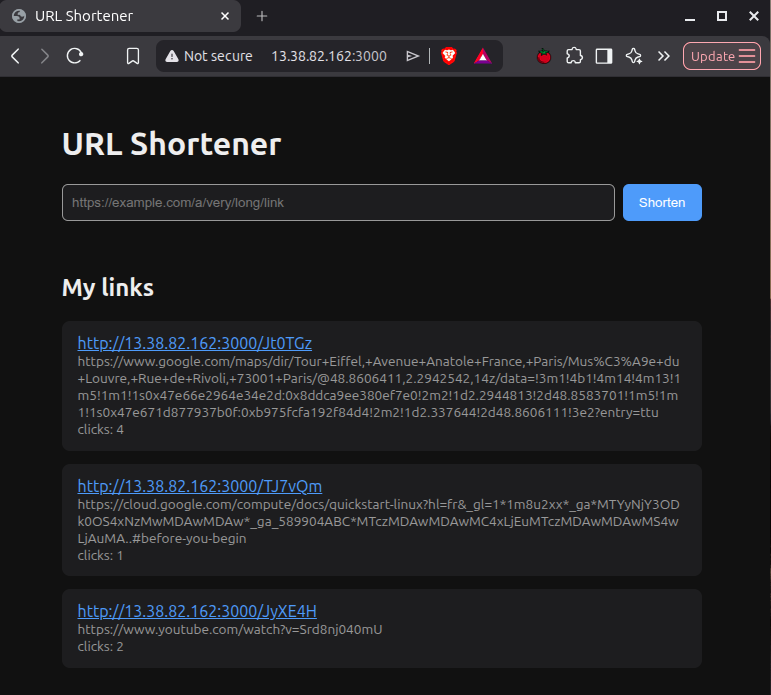
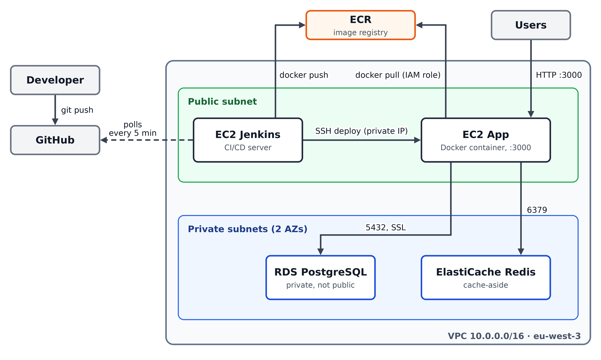
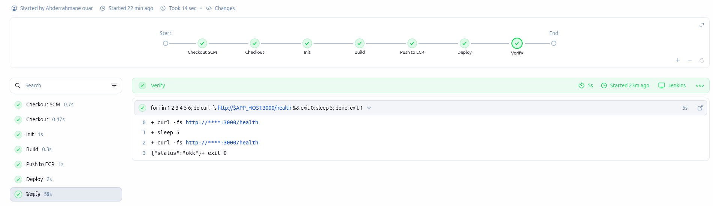
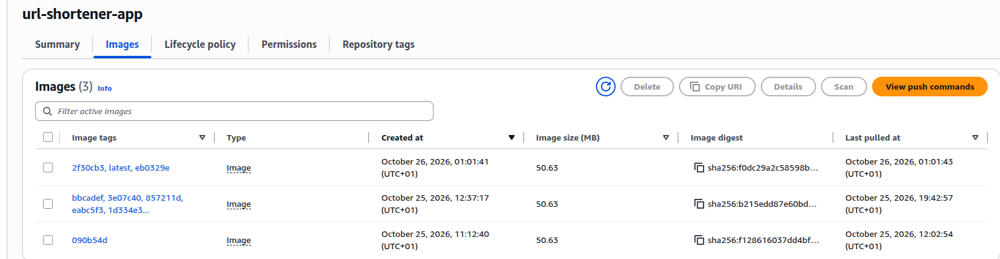
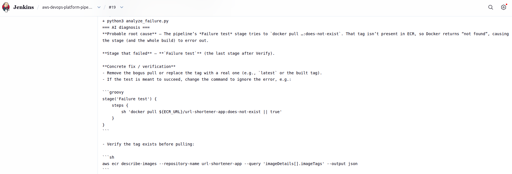
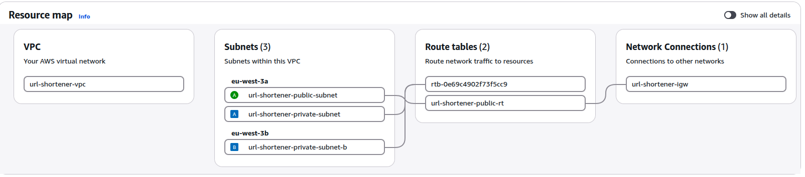
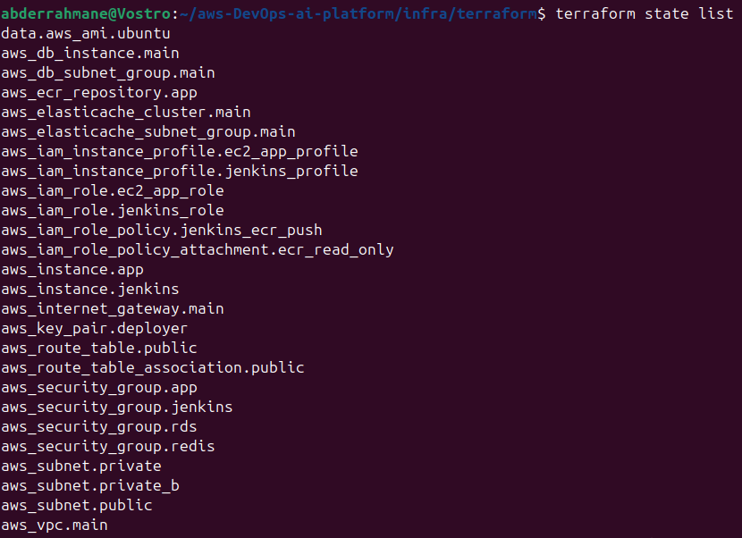

# AWS DevOps Platform: URL Shortener with CI/CD

A small URL shortener used to build a complete DevOps workflow on AWS: Terraform infrastructure, a Jenkins pipeline that deploys a Docker image on every push, managed PostgreSQL and Redis in private subnets, and an LLM that explains failed builds.



**Stack:** Node.js/Express, PostgreSQL (RDS), Redis (ElastiCache, cache-aside), Docker, Terraform, Jenkins, ECR, a free-tier LLM API.

## Architecture
 

 
*One VPC in eu-west-3. Only the two EC2 instances sit in the public subnet; the database and the cache are in private subnets.*

## CI/CD

`git push` → Jenkins polls GitHub → build image → push to ECR (Git SHA tag + `latest`) → SSH deploy to the app instance over its private IP → `/health` check.





## AI-assisted failure analysis

When a build fails, `analyze_failure.py` masks account IDs and IPs in the log tail, sends it to a free-tier LLM and prints the probable cause and a fix. It never blocks the build, treats the log as untrusted input, and only displays its output.



## Infrastructure

Everything is created with Terraform.

- RDS and Redis sit in private subnets and accept traffic only from the app's Security Group.
- One IAM role per instance and no static AWS keys. Jenkins can push only to this ECR repository.
- SSH and the Jenkins UI are limited to my IP.
- The database password lives only in a sensitive Terraform variable and on the app host, never in the repo or in Jenkins.





## Run it

Locally:

```bash
cp app/.env.example app/.env
docker compose up -d --build
```

On AWS: create `infra/terraform/terraform.tfvars` with `my_ip` and `db_password`, then:

```bash
cd infra/terraform
terraform init && terraform apply
```

## Limitations and next steps

- Prometheus and Grafana are in progress.
- The app host setup and database migrations are manual; they should move to `user_data` or Ansible and a pipeline step.
- Plain HTTP on port 3000; an ALB with an ACM certificate would add TLS.
- Terraform state is local; it should move to S3 with locking.
- The database connection is encrypted but the server certificate is not verified.

RDS, ElastiCache and the EC2 instances bill hourly, so I run `terraform destroy` when idle.

Cloud & DevOps engineering student at INPT, Rabat. [GitHub](https://github.com/Abderrahmmane-Ouarach)
